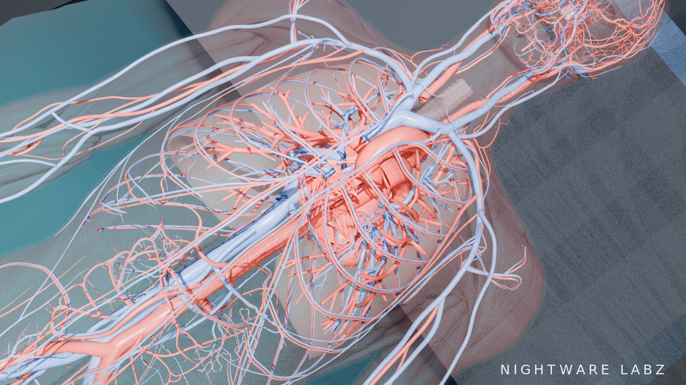

# ANATOMICA



*The cardiovascular system — a still from ANATOMICA's surgical simulation film.*

An open medical surgical and anatomy system: a 3D anatomical atlas, a physiology
simulation engine, an imaging suite, a surgical procedure simulator, and a clinical
case and hypothesis workbench — all reading one verified model of the human body.

ANATOMICA is an educational and simulation system. It is not a clinical device, it
carries no real patient data, and it is not for diagnosis or treatment of real persons.

## Principles

- **One body, one truth.** Every module derives from the same Body Model; modules
  never keep private copies of anatomy or physiology.
- **Data before rendering.** A structure exists because its record is verified —
  nomenclature, counts, and relations traceable to named sources. Uncertain items
  carry a visible *verify* flag instead of a silently chosen answer.
- **Derived, never invented.** Geometry comes from segmented human anatomy adopted
  under compatible licenses, tracked per file in a provenance ledger.
- **Computed, not scripted.** Vitals and labs are outputs of a running physiological
  state; complications in the operating theatre are computed by the engine.
- **Open forever.** The whole system is licensed AGPL-3.0.

## How to use

Get the code first: clone this repository or download it as an archive.
There are no accounts, no server, and no telemetry — every module runs
locally. ANATOMICA is for education and simulation only; never use it on
a real patient.

### 1. Explore the body — the web shell (easiest start)

Serve the `web/` folder with any static file server and open it in a
browser (the viewer loads its data packs over HTTP, so opening the file
directly will not work):

```sh
cd web
python3 -m http.server 8000
# open http://localhost:8000
```

- **Move:** drag to orbit, scroll to zoom, Shift-drag (or right/middle
  drag) to pan, pinch on touch screens. **Reset view** restores the
  starting camera.
- **Find a structure:** type in the **Search** box (name, Terminologia
  Anatomica name, or record id), filter by region, or click a row in the
  record list. Clicking a mesh in the 3D view selects it too — the
  selected structure highlights, the rest dim (toggleable), and its full
  record opens in the right-hand panel.
- **Layers:** toggle the eleven body systems on and off to build the
  view you need, from full body down to a single system. The **labels**
  and **wireframe** toggles sit in the header.
- **Imaging:** switch from **Atlas** to **Imaging** in the header. Step
  through slices with the slider or the slice buttons, adjust
  window/level with the presets or the Width/Level sliders, click a
  voxel to identify what it is, click a legend row to isolate a label,
  and use **MPR planes** for crosshair-linked axial, coronal, and
  sagittal views of the same volume. Imaging here is synthetic and
  derived from the Body Model, and is labelled as such.

### 2. The native application (flagship viewer)

Needs a Rust toolchain and a machine with a display and GPU:

```sh
cd native
cargo run --release -- view     # windowed viewer
cargo run --release -- verify   # headless check: loads the packs, runs
                                # the assertions, renders proof frames
                                # to native/frames/
```

In the viewer: mouse orbit, wheel zoom, right-drag pan, left click
picks a structure (its record prints to the console and the mesh
highlights). Keys: **S** skeletal, **M** muscular, **1–0** toggle
layers, **I** integumentary, **A** all layers, **G** glass shell (skin
translucent), **W** wireframe, **R** reset view.

### 3. Run the physiology engine

```sh
cd physiology
cargo run --release -- validate        # resting outputs checked against
                                        # every published normal range
cargo run --release -- run course       # a −1,500 mL haemorrhage, untreated
                                        # vs crystalloid / whole blood /
                                        # component transfusion arms
cargo run --release -- run hormones     # water, sodium, and ADH axes
cargo run --release -- run respiratory  # respiratory and acid–base cases
```

Every run is deterministic: the same command always produces the same
trace, and each run prints a trace hash and a PASS/FAIL line per output
against its cited expectation.

### 4. Operate — the Theatre (surgical simulator)

```sh
cd theatre
cargo run --release -- validate   # check every procedure, parameter,
                                  # and instrument record
cargo run --release -- run-all    # run all shipped attempt traces and
                                  # write their scored debriefs
cargo run --release -- run <trace.json> [--out <debrief.json>]
```

A procedure is a step graph over the atlas anatomy; an attempt is a
trace JSON (see `theatre/traces/` for examples to copy). The runner
scores the attempt and emits a debrief. Safety gates are enforced as
the specialty defines them: in laparoscopic cholecystectomy, dividing
a structure before the Critical View of Safety is demonstrated fails
the attempt, because the model resolves the divided structure as the
common bile duct — the real injury mechanism. Scores are formative
only: the expert-review gate recorded in the procedure files is not
yet met, and the files say so.

### 5. Work a case — the case and hypothesis workbench

```sh
python3 tools/case_run.py   # score every shipped case and print its
                            # board, stage by stage
```

Each case in `cases/` presents in stages. To work one yourself, write
an attempt JSON alongside the examples in `cases/attempts/`: commit a
differential with explicit probabilities, update it as each stage's
findings arrive, and order tests knowing each carries cost and
information value. The runner recomputes the workbench board from the
cited likelihood ratios, evaluates the guideline criteria mechanically,
scores your board (per-stage Brier scores, rank of the true diagnosis —
there is deliberately no single composite score), and writes a
PEARLS-structured debrief to `cases/debriefs/`.

### 6. Check the data yourself

Nothing here asks to be taken on trust. The tools in `tools/` recompute
the claims in this README from the data itself — `tools/census.py`
for the Body Model census, and a `*_check.py` beside every data module
and subsystem. If a checker and this README ever disagree, the checker
is right.

## Layout

| Path | Contents |
|---|---|
| `design/` | Buildable design documents for every area of the system (10 documents) |
| `data/` | Body Model data modules, one folder per body system; `data/sources/` holds adopted source datasets with their provenance |
| `tools/` | Verification tooling: provenance ledger builder, censuses, checkers, assemblers and record builders — every checker in the family exits 0 on this tree |
| `native/` | The native application (flagship) — Rust + wgpu |
| `web/` | The browser application (universal-access companion) — WebGL2 atlas/imaging viewer, the WebAssembly engine package (`pkg/`), and the case workbench; the full system runs in the browser |
| `wasm/` | The physiology and Theatre engines as a wasm-bindgen crate, with its native-vs-wasm verification harness |
| `physiology/` | The deterministic physiology engine — Rust |
| `theatre/` | The surgical procedure simulator — Rust engine, procedure models, traces, debriefs |
| `cases/` | The case and hypothesis workbench — cases, learner attempts, debriefs, FHIR export |
| `cases-harness/` | Golden-debrief harness for the web case-workbench port |
| `film-engine/` | The surgical simulation film engine — Blender pipeline, geometry inputs, and the patient scene archive (see `film-engine/README.md`) |
| `research/` | The research library the design rests on (3 rounds, 31 fronts) |
| `assets/` | README and project imagery |
| `milestones/` | The milestone reports, one per milestone (listed below) |

## Status

**Milestones 1–59 are complete and recorded in `milestones/MILESTONE-1.md`
through `milestones/MILESTONE-59.md`** (plus the Milestone 7 pick-layer fix). The Body Model
stands at **2,236 inventory records** across all eleven body systems, with
geometry for 1,545 of them. **691 concept records carry no geometry** (684 of
them FMA 5.1.0 concept records, the other 7 the six auditory ossicles and the
coccyx, which no adoptable dataset carries as separate structures). Clinical
coverage is 401 sourced clinical records (Tier A 239 / Tier B 121 / Tier C 41).

**Concepts are complete; geometry is the open question.** The concept gaps
that the Body Model v1 status once listed — nerves beyond cranial nerves
II–V1, lymphatic vessels and nodes, thyroid and parathyroid geometry, the
kidney and urinary interior, the internal female reproductive tract, skin
layers / nails / glands — were closed as concepts by the FMA 5.1.0 intake
arc (Milestones 33–38: 684 records intaken, all concept-only). What remains
open is geometry for those records: a Z-Anatomy geometry audit (Milestone 34)
cleared provenance for 555 of 587 anatomical objects and validated a
brain-assembly transform (held-out 0.27 mm), but global registration was
refuted, and **no Z-Anatomy geometry has been intaken**.
**The geometry decision is open.** Six named structures have no FMA class at all
(bulbourethral gland, paraurethral glands, cervical canal, isthmus of
uterus, keratinocyte, crus of penis) and are recorded as gaps, not
invented. The deferent-duct meshes exist in BodyParts3D 4.0 (FJ3135/FJ3140)
but stay deliberately unclaimed until the geometry ruling.

**Expert review is the standing open gate.** For every Theatre procedure and
every case, the expert-review gate is UNMET: no named independent reviewers
exist, so all content is `dual-sourced-draft`, all scores are
formative-only, and no composite score is published anywhere in the system.
Reviewers are never invented to fill the block.

Both shells render the real assembled geometry — the native Rust + wgpu flagship
and the WebGL2 browser companion — and the deterministic physiology engine's
resting outputs validate against published normal ranges (33 resting ranges
gated, all passing, resting trace hash `0x6369b10e9a71c872`).

## Modules

### Atlas — the Body Model

One inventory across eleven body systems, assembled from BodyParts3D 4.0
geometry (CC BY-SA 2.1 Japan governs the mesh headers; CC BY 4.0 per the
DBCLS release page) and TotalSegmentator v1.0 labels (CC BY 4.0), with
concepts intaken from FMA 5.1.0 (CC BY 4.0, hash-pinned in the provenance
ledger). Every record carries its provenance; geometry is packed into one
merged buffer set per layer (1 draw call per layer) — **8,087,374 triangles**
(304,367,896 bytes canonical, 123,352,401 bytes as gzip delivery).

| System | Inventory | With geometry | Clinical |
|---|---|---|---|
| skeletal | 206 | 199 | 0 |
| muscular | 359 | 359 | 127 |
| cardiovascular | 646 | 646 | 69 |
| nervous | 419 | 133 | 92 |
| respiratory | 83 | 83 | 37 |
| digestive | 93 | 93 | 31 |
| urinary | 73 | 6 | 6 |
| lymphatic | 135 | 4 | 4 |
| endocrine | 17 | 3 | 6 |
| reproductive | 146 | 13 | 16 |
| integumentary | 59 | 6 | 13 |
| **Total** | **2,236** | **1,545** | **401** |

Terminologia Anatomica 2 (TA2) Latin names are resolved for **854 of the
1,045 records** the TA2 pass covers (361 clinical + 684 FMA concept
records); **117 ambiguous** and **74 not found**, each carrying a dated
reason. The nephron-segment records are among the not-found: TA2 carries no
nephron-segment terms, and naming them awaits a Terminologia Histologica
source decision.

### Physiology — the deterministic engine

A Rust compartment engine whose resting state validates against published
normal ranges (MAP 73.1 mmHg, cardiac output 4.21 L/min, PaCO₂ 41.1 mmHg,
PaO₂ 91.2 mmHg, pH 7.39, oxygen delivery 828 mL/min, ionized calcium
1.20 mmol/L, PTH 19.8 pg/mL). It carries
**161 parameters** from **80 sources** (90 cited, 44 calibrated within cited
ranges, 27 verify-flagged), 33 validation ranges, and 26 perturbation
cases — circulation with a four-effector baroreflex and first-class Guyton
venous return, renal excretion and the interstitial reservoir, the oncotic
state with blood products as scenario inputs, the ADH and aldosterone axes,
and a respiratory module (ventilation, gas exchange, chemoreflex, the Bohr
shift, and chronic renal acid–base compensation on a days timescale) coupled
one-way, and a calcium–PTH axis (PTH secretion on the Brown sigmoid;
renal, bone and gut limbs) folded into the respiratory-side state — so
the case-pinned circulation baseline is bit-identical by construction. Its validator reports ALL HARD GATES PASS.

### Imaging — synthetic CT and MPR

Two synthetic DICOM CT series derived from TotalSegmentator subjects, each
with a Body Model crosswalk: subject s0778 (431 DICOM instances, 262 × 262 ×
431 voxels at 1.5 mm isotropic) and subject s1090 (439 DICOM instances,
257 × 257 × 439 voxels at 1.5 mm isotropic) — 870 instances in all. The
series are synthetic throughout (watermarked "SYNTHETIC" in metadata and
burned into every slice's pixels; no real patient data). **93 of the 104
labels mapped** in both subjects; s0778's present labels reach 90 Body Model
records; s1090's reach 88 Body Model records. The viewer offers tri-plane
MPR (exact re-indexing reslice, no interpolation) and subject switching. A
DICOM conformance defect in the series descriptions was found and repaired
at Milestones 45–46 (an over-long SeriesDescription string in all 870
instances; the writer now refuses to emit a non-conforming value), and an
independent toolkit pass (pydicom/nibabel) corroborates the derivation:
pixel arrays exact against the sources, the watermark proven to be the only
source-to-series alteration.

### Theatre — the procedure simulator

**6 authored procedures**, 54 phases / 88 steps / 290 microsteps, with
30 scripted traces and 30 generated debriefs: laparoscopic cholecystectomy
(Critical View of Safety), laparoscopic appendicectomy (base
identification), open carpal tunnel release (nerve identification), ulnar
nerve decompression (nerve protection, transposition), laparoscopic
inguinal hernia repair (triangle-of-doom / triangle-of-pain gate, two gated
verbs: divide and fixate), and total thyroidectomy (per-side recurrent
laryngeal nerve identification and parathyroid preservation; nerve
monitoring is an adjunct and cannot satisfy the gate). The Theatre carries
**48 sources** (T1–T48; T42–T48 added at Milestone 56 to the T1–T41),
**17 parameters**, 12 of them verify-flagged, and **33 instruments**. Safety
gates are scored exactly as the specialties define them — dividing an
unidentified critical structure fails the attempt — and complications are
computed by the engine against the physiology state. All six procedures
run on one generalized engine, and the checker family replays every trace
(theatre_check: 736 checks, 0 failures). Expert review is UNMET for every
procedure (see Status).

### Cases — the workbench

**8 cases** in the library, staged history → examination → tests → board,
with a source register (62 sources, C1–C62), guideline criteria evaluated
mechanically from the staged evidence, likelihood ratios only where sourced,
and exactly one scored anchoring event per model-learner attempt. Case #2 is
case #1's patient on postoperative day 4 after the Theatre's failed
cholecystectomy, hash-linked to the trace itself; cases #4 and #5 localize
lesions by branch anatomy; case #6 is the first cardiopulmonary case
(pulmonary embolism, Wells/PERC/CURB-65/ESC blocks, A–a gradient
re-derived by the checker); case #7 walks the pathway case #6 recorded but
did not take — Wells 0.0 complete, PERC's gestalt precondition met, a
D-dimer below the age-adjusted cutoff (560 against 620 µg/L, ADJUST-PE) —
so PE is excluded without imaging, over-testing is the scored error, and
the D-dimer LR− (0.0732) is registered for the negative direction. Case #8
is the trace-30 patient on postoperative day 1 — symptomatic
hypocalcemia after the passed thyroidectomy whose parathyroid criterion
went unaccounted — hash-linked to the Theatre debrief, with Trousseau's
sign registered at the conservative end (LR+ 23.5) and the anchor an
inherited anxiety/hyperventilation attribution, a real mechanism that
cannot lower a total calcium. Cases
hand off to Theatre procedures where one
exists, and state the absence where none does. The FHIR-shaped export is
checked against the case files by the same checker (case_check: 13,135
checks passed, 0 failed). Expert review is UNMET for every case (see
Status).

## Verification

Every number in this README that the tree can compute is asserted by
`tools/readme_check.py`, which recomputes the census, the TA2 ledger
totals, the pack totals, the physiology counts, the theatre and case
counts, the imaging counts, the milestone index, and the file index from
the data files themselves, and re-runs the sibling checkers to compare
their printed totals with the table below. Run it as
`python3 tools/readme_check.py` — exit 0 means the README agrees with the
tree.

| Check | Result |
|---|---|
| `tools/assembly_check_all.py` | ALL GATED CHECKS PASS |
| `tools/theatre_check.py` | 736 checks, 0 failures |
| `tools/case_check.py` | 13,135 checks passed, 0 failed |
| `tools/imaging_toolkit_check.py` | 84 hard checks PASS, 0 conformance findings standing |
| `tools/verify_web.js` | ALL CHECKS PASS (W1–W10) |
| physiology `validate` | ALL HARD GATES PASS |
| native `verify` | 99 data/pack assertions PASS, 0 FAIL |
| all other `tools/*_check.py` | exit 0 |

The native verifier's data/pack assertions run here (99 PASS, 0 FAIL).
Its GPU render stage needs a graphics adapter: where one exists — a
software GL stack such as llvmpipe suffices — the verifier also renders
its frames and prints 107 assertions (the 99 plus five frame silhouettes
against the CPU vertex projection, the Milestone 21 translucency proof,
and two picking checks), as observed on the instance that served this
tree before the 2026-11-07 VM replacement. On the current instance no
adapter can initialise (the GL/Vulkan driver libraries cannot be
loaded), so the render stage is asserted by the web checker (W1–W10)
and the pack/data checks instead, and the table carries the 99 the
verifier prints here; `tools/readme_check.py` re-derives the count on
every run.

## Milestones

| Milestone | Report | What landed |
|---|---|---|
| 1 | `MILESTONE-1.md` | Design complete (10 design documents) + P2 geometry foundation and repo scaffold |
| 2 | `MILESTONE-2.md` | Skeletal system: FMA-ID mapping and geometry conversion for all 206 bones |
| 3 | `MILESTONE-3.md` | TotalSegmentator intake (10 subjects, full 1,204-subject index) + registered skeleton assembly: 199 records, 511,968 faces |
| 4 | `MILESTONE-4.md` | Muscular system: 359 inventory / geometry records, 127 sourced clinical records |
| 5 | `MILESTONE-5.md` | Cardiovascular system: 646 records, 69 clinical records + 8 variant records |
| 6 | `MILESTONE-6.md` | Muscular assembly + Web Shell v2 rendering the real assembled skeleton and muscle layers |
| 7 | `MILESTONE-7.md` | Native shell: Rust + wgpu application rendering the real Body Model packs |
| 7 (fix) | `MILESTONE-7-FIX.md` | Web viewer pick-layer bug fix, with a regression check that executes the shipped decoder |
| 8 | `MILESTONE-8.md` | Physiology engine v0: deterministic cardiovascular compartment model, 46 cited parameters, resting outputs inside all cited normal ranges |
| 9 | `MILESTONE-9.md` | Nervous system: 133 records, 52 sourced clinical records; the nerve-concept gap quantified exactly |
| 10 | `MILESTONE-10.md` | Respiratory system: 83 records, 37 clinical records (all Tier A) |
| 11 | `MILESTONE-11.md` | Digestive system: 93 records, 31 clinical records, all eight Couinaud liver segments |
| 12 | `MILESTONE-12.md` | Urinary system: 6 records, 6 clinical records (all Tier A) — the system's entire interior is absent from the source datasets |
| 13 | `MILESTONE-13.md` | Lymphatic system (4 records, 4 clinical) + endocrine system (3 records, 6 clinical) |
| 14 | `MILESTONE-14.md` | Reproductive system: 13 records, 16 clinical records — 14 male concepts vs 1 female concept in the source release |
| 15 | `MILESTONE-15.md` | Integumentary system: 6 records, 13 clinical records — closes the eleven-system census: Body Model v1 |
| 16 | `MILESTONE-16.md` | Shells integration: all 11 system layers assembled and packed (8,087,374 triangles), both shells render the full Body Model |
| 17 | `MILESTONE-17.md` | Theatre v1: laparoscopic cholecystectomy — 9 phases / 21 steps / 86 microsteps, Critical View of Safety gate; divide-before-CVS is a Stewart–Way class III bile duct injury and fails the attempt |
| 18 | `MILESTONE-18.md` | Physiology v1: venomotor recruitment + transcapillary refill; −750 mL haemorrhage lands inside the ATLS Class II band |
| 19 | `MILESTONE-19.md` | Imaging v1: synthetic DICOM CT series of TotalSegmentator subject s0778 (431 instances), Body Model crosswalk, watermark in metadata and pixels |
| 20 | `MILESTONE-20.md` | Case Workbench v1 + Case #1: acute cholecystitis, TG18 mechanically evaluated |
| 21 | `MILESTONE-21.md` | Physiology: contractility effector (fourth baroreflex effector) + per-layer opacity in both shells |
| 22 | `MILESTONE-22.md` | Case #2: post-operative bile duct injury — case #1's patient on postoperative day 4 after the Theatre's failed cholecystectomy, hash-linked to the trace |
| 23 | `MILESTONE-23.md` | TA2 name pass: Terminologia Anatomica 2 Latin names over the clinical records (340/361 resolved) |
| 24 | `MILESTONE-24.md` | Physiology: venous return first-class (Guyton readout); the −1,500 mL "decompensation" resolved as a sampling artifact — no parameter changed |
| 25 | `MILESTONE-25.md` | Physiology: renal excretion + interstitial reservoir |
| 26 | `MILESTONE-26.md` | Physiology: oncotic state + blood products as scenario inputs |
| 27 | `MILESTONE-27.md` | Web delivery: gzip pack compression (290.3 → 117.6 MiB) via DecompressionStream, progressive per-layer loading |
| 28 | `MILESTONE-28.md` | Theatre procedure #2: laparoscopic appendicectomy; base-identification gate; engine generalized, cholecystectomy debriefs byte-identical |
| 29 | `MILESTONE-29.md` | Case #3: appendicitis — Alvarado 10/10 vs AIR 6/12 disagreement adjudicated per WSES Jerusalem 2020 |
| 30 | `MILESTONE-30.md` | Physiology: hormonal volume axes (ADH + aldosterone) |
| 31 | `MILESTONE-31.md` | Imaging MPR: tri-plane multiplanar reconstruction with exact re-indexing reslice, no interpolation |
| 32 | `MILESTONE-32.md` | Imaging: second subject s1090 (439 instances) + viewer subject switching |
| 33 | `MILESTONE-33.md` | FMA concept intake #1: 286 nervous-system concept records from FMA 5.1.0 (CC BY 4.0); nervous 133 → 419 records |
| 34 | `MILESTONE-34.md` | Z-Anatomy geometry audit: provenance cleared for 555 of 587 anatomical objects; global registration refuted, brain-assembly transform validated (0.27 mm); no intake — the geometry decision is open |
| 35 | `MILESTONE-35.md` | TA2 pass over the FMA nerve records (194/286 resolved) + muscle innervation re-pointing (2 → 69 nerve records linked) |
| 36 | `MILESTONE-36.md` | FMA intake #2: lymphatic 4 → 135 records, endocrine 3 → 17 |
| 37 | `MILESTONE-37.md` | FMA intake #3: urinary 6 → 73, female reproductive 13 → 70; six plexus records corrected on dual-parse evidence |
| 38 | `MILESTONE-38.md` | FMA intake #4 (final): integumentary 6 → 59, male reproductive +76 — concept-intake arc closed at 684 FMA records; Body Model 2,236 |
| 39 | `MILESTONE-39.md` | Major-nerve clinical tranche: 40 records (cranial, plexus, limb) — clinical records 361 → 401 |
| 40 | `MILESTONE-40.md` | Deferent-duct checker repair: the M14 "absence" was a Latin-name probe miss (BP3D carries FJ3135/FJ3140); checker partition-scoped, regression gate added; zero data files changed |
| 41 | `MILESTONE-41.md` | Case #4: carpal tunnel syndrome — first localization case; CTS-6; board 0.78 → 0.99 |
| 42 | `MILESTONE-42.md` | Theatre procedure #3: open carpal tunnel release; nerve-identification gate; Case #4 hands off |
| 43 | `MILESTONE-43.md` | Case #5: ulnar neuropathy localization (elbow vs wrist vs root) |
| 44 | `MILESTONE-44.md` | Theatre procedure #4: ulnar nerve decompression, transposition authored with the equipoise scored as the evidence dictates; Case #5 hands off |
| 45 | `MILESTONE-45.md` | Imaging toolkit pass: both DICOM series validated externally (pydicom/nibabel; 870 instances, 58.58M voxels exact); one conformance defect found (SeriesDescription 67 > 64 chars) |
| 46 | `MILESTONE-46.md` | That defect repaired at the writer + permanent VR gate; both series re-derived, pixel identity 870/870, toolkit check clears with 0 findings |
| 47 | `MILESTONE-47.md` | Physiology: respiratory module — ventilation + gas exchange; resting gases inside cited bands; pinned circulation baseline bit-identical |
| 48 | `MILESTONE-48.md` | Case #6: acute dyspnoea — pulmonary embolism; Wells/PERC/CURB-65/ESC blocks, A–a gradient re-derived by the checker |
| 49 | `MILESTONE-49.md` | Theatre procedure #5: laparoscopic inguinal hernia repair (TAPP) — triangle-of-doom / triangle-of-pain gate over two gated verbs (divide + fixate) |
| 50 | `MILESTONE-50.md` | README reconciliation: the public index brought current through M49, with `tools/readme_check.py` guarding it against drift |
| 51 | `MILESTONE-51.md` | Physiology: two-way coupling — hypoxic ventilatory drive + metabolic–circulatory feedback, both exactly zero at the resting equilibrium; pinned baseline bit-identical |
| 52 | `MILESTONE-52.md` | Physiology: the Bohr shift — pH-dependent P50 anchored exactly on the resting pH; resting readouts bit-identical; the M47 deferral list (hypoxic drive, metabolic feedback, Bohr shift) closed |
| 53 | `MILESTONE-53.md` | Physiology: chronic acid–base compensation — a slow renal bicarbonate state on the cited chronic relations (direction-specific) and a days timescale; sustained arms recover pH toward, not to, normal; resting baseline and Bohr anchor bit-identical |
| 54 | `MILESTONE-54.md` | Case #7: pulmonary embolism rule-out — the pathway case #6 recorded but did not walk: Wells 0.0 complete, PERC precondition met, D-dimer 560 below the age-adjusted 620 cutoff (ADJUST-PE); PE excluded without imaging, over-testing scored as the error, D-dimer LR− 0.0732 registered |
| 55 | `MILESTONE-55.md` | README reconciliation, final pass: the "How to use" section Chase added on main (ca36d943) merged verbatim, all figures brought current through M54, file index regenerated; readme_check fully green — the imaging-toolkit harness failure diagnosed as the environment's missing pinned toolkits (pydicom 3.0.2 / nibabel 5.4.2), restored |
| 56 | `MILESTONE-56.md` | Theatre procedure #6: total thyroidectomy — per-side recurrent laryngeal nerve identification and parathyroid preservation gate; nerve monitoring is adjunct-only and cannot satisfy the gate (a probe pins it); extralaryngeal branching variant at cited prevalence, the 0.7% non-recurrent nerve below the authoring gate and not authored; the bilateral gate exposed a first-demonstration criteria bug, fixed with all 25 prior debriefs byte-identical |
| 57 | `MILESTONE-57.md` | Case #8: post-thyroidectomy hypocalcemia — the trace-30 patient on postoperative day 1, hash-linked to the Theatre debrief; Trousseau LR+ 23.5 registered at the conservative end; the anchor an inherited anxiety/hyperventilation attribution |
| 58 | `MILESTONE-58.md` | Physiology: the calcium–PTH axis — PTH secretion on the Brown four-parameter sigmoid, renal/bone/gut limbs; resting ionized calcium and PTH inside cited normals, the PTH-loss arm reproducing Case #8's postoperative-day-2 values; resting circulation baseline bit-identical |
| 59 | `MILESTONE-59.md` | README final pass: figures and file index brought current through M58 and the landed browser build (web/wasm/cases-harness on main), the merged "How to use" section re-proven byte-identical; readme_check fully green |

## File index

All 632 files in this repository, by directory. Adopted source-dataset binaries (meshes, archives, GLBs, segmentation masks) and build output are not tracked in git — see `.gitignore`; their provenance is recorded in `data/sources/*/ledger.json` and `SOURCE.md`. Regenerable artifacts (geometry packs and their gzip variants, DICOM series and web slice bins) are likewise not tracked: they are products of the shipped derivation and packing tools, and their identity is asserted by the checkers.

### Root — 3 files

- `.gitignore`
- `LICENSE`
- `README.md`

### `assets/` — 1 files

- `assets/anatomica-hero.jpg`

### `cases/` — 27 files

- `cases/README.md`
- `cases/attempts/attempt.case-acute-dyspnea-006.model-learner.json`
- `cases/attempts/attempt.case-appendicitis-003.model-learner.json`
- `cases/attempts/attempt.case-carpal-tunnel-004.model-learner.json`
- `cases/attempts/attempt.case-pe-ruleout-007.model-learner.json`
- `cases/attempts/attempt.case-post-op-002.model-learner.json`
- `cases/attempts/attempt.case-post-thyroid-hypocalcemia-008.model-learner.json`
- `cases/attempts/attempt.case-ruq-pain-001.model-learner.json`
- `cases/attempts/attempt.case-ulnar-neuropathy-005.model-learner.json`
- `cases/case.acute-dyspnea.006.json`
- `cases/case.appendicitis.003.json`
- `cases/case.carpal-tunnel.004.json`
- `cases/case.pe-ruleout.007.json`
- `cases/case.post-op-jaundice.002.json`
- `cases/case.post-thyroid-hypocalcemia.008.json`
- `cases/case.ruq-pain.001.json`
- `cases/case.ulnar-neuropathy.005.json`
- `cases/debriefs/debrief.case-acute-dyspnea-006.model-learner.json`
- `cases/debriefs/debrief.case-appendicitis-003.model-learner.json`
- `cases/debriefs/debrief.case-carpal-tunnel-004.model-learner.json`
- `cases/debriefs/debrief.case-pe-ruleout-007.model-learner.json`
- `cases/debriefs/debrief.case-post-op-jaundice-002.model-learner.json`
- `cases/debriefs/debrief.case-post-thyroid-hypocalcemia-008.model-learner.json`
- `cases/debriefs/debrief.case-ruq-pain-001.model-learner.json`
- `cases/debriefs/debrief.case-ulnar-neuropathy-005.model-learner.json`
- `cases/fhir/case.ruq-pain.001.bundle.json`
- `cases/parameters.json`

### `cases-harness/` — 2 files

- `cases-harness/RESULTS.md`
- `cases-harness/run.js`

### `data/` — 87 files

- `data/cardiovascular/cardiovascular.json`
- `data/cardiovascular/cv-assembled.json`
- `data/cardiovascular/cv-geometry.json`
- `data/cardiovascular/cv-inventory.json`
- `data/digestive/digestive-assembled.json`
- `data/digestive/digestive-geometry.json`
- `data/digestive/digestive-inventory.json`
- `data/digestive/digestive.json`
- `data/endocrine/endocrine-assembled.json`
- `data/endocrine/endocrine-geometry.json`
- `data/endocrine/endocrine-inventory.json`
- `data/endocrine/endocrine.json`
- `data/fma-intake-36.json`
- `data/fma-intake-37.json`
- `data/fma-intake-38.json`
- `data/imaging/README.md`
- `data/imaging/s0778/crosswalk.json`
- `data/imaging/s0778/series.json`
- `data/imaging/s1090/crosswalk.json`
- `data/imaging/s1090/series.json`
- `data/innervation-link-pass.json`
- `data/integumentary/integumentary-assembled.json`
- `data/integumentary/integumentary-geometry.json`
- `data/integumentary/integumentary-inventory.json`
- `data/integumentary/integumentary.json`
- `data/lymphatic/lymphatic-assembled.json`
- `data/lymphatic/lymphatic-geometry.json`
- `data/lymphatic/lymphatic-inventory.json`
- `data/lymphatic/lymphatic.json`
- `data/muscular/muscle-geometry.json`
- `data/muscular/muscle-inventory.json`
- `data/muscular/muscles-assembled.json`
- `data/muscular/muscles.json`
- `data/nervous/major-nerves.json`
- `data/nervous/nervous-assembled.json`
- `data/nervous/nervous-geometry.json`
- `data/nervous/nervous-inventory.json`
- `data/nervous/nervous.json`
- `data/reproductive/reproductive-assembled.json`
- `data/reproductive/reproductive-geometry.json`
- `data/reproductive/reproductive-inventory.json`
- `data/reproductive/reproductive.json`
- `data/respiratory/respiratory-assembled.json`
- `data/respiratory/respiratory-geometry.json`
- `data/respiratory/respiratory-inventory.json`
- `data/respiratory/respiratory.json`
- `data/skeletal/fma-mapping.json`
- `data/skeletal/gap-analysis.md`
- `data/skeletal/skeleton-assembled.json`
- `data/skeletal/skeleton-geometry.json`
- `data/sources/bodyparts3d-4.0/LICENSE-PAGE.html`
- `data/sources/bodyparts3d-4.0/README_e.html`
- `data/sources/bodyparts3d-4.0/SHA256SUMS.local`
- `data/sources/bodyparts3d-4.0/SOURCE.md`
- `data/sources/bodyparts3d-4.0/isa_element_parts.txt`
- `data/sources/bodyparts3d-4.0/isa_inclusion_relation_list.txt`
- `data/sources/bodyparts3d-4.0/isa_parts_list_e.txt`
- `data/sources/bodyparts3d-4.0/ledger-summary.md`
- `data/sources/bodyparts3d-4.0/ledger.json`
- `data/sources/bodyparts3d-4.0/partof_element_parts.txt`
- `data/sources/bodyparts3d-4.0/partof_inclusion_relation_list.txt`
- `data/sources/bodyparts3d-4.0/partof_parts_list_e.txt`
- `data/sources/bodyparts3d-4.0/release_4.0_e.html`
- `data/sources/fma-5.1.0/ChangeLog.txt`
- `data/sources/fma-5.1.0/LICENSE`
- `data/sources/fma-5.1.0/README.md`
- `data/sources/fma-5.1.0/SOURCE.md`
- `data/sources/fma-5.1.0/Version.txt`
- `data/sources/fma-5.1.0/ledger-summary.md`
- `data/sources/fma-5.1.0/ledger.json`
- `data/sources/ta2-2.07/SOURCE.md`
- `data/sources/ta2-2.07/ta2-terms.json`
- `data/sources/totalsegmentator-1.0/SOURCE.md`
- `data/sources/totalsegmentator-1.0/index-census.json`
- `data/sources/totalsegmentator-1.0/labels.json`
- `data/sources/totalsegmentator-1.0/labels.md`
- `data/sources/totalsegmentator-1.0/ledger-summary.md`
- `data/sources/totalsegmentator-1.0/ledger.json`
- `data/sources/z-anatomy-glb/License.txt`
- `data/sources/z-anatomy-glb/SOURCE.md`
- `data/sources/z-anatomy-glb/ledger-summary.md`
- `data/sources/z-anatomy-glb/ledger.json`
- `data/ta2-name-pass.json`
- `data/urinary/urinary-assembled.json`
- `data/urinary/urinary-geometry.json`
- `data/urinary/urinary-inventory.json`
- `data/urinary/urinary.json`

### `design/` — 10 files

- `design/01-architecture.md`
- `design/02-body-model-schema.md`
- `design/03-geometry-pipeline.md`
- `design/04-physiology-engine.md`
- `design/05-theatre.md`
- `design/06-imaging.md`
- `design/07-cases.md`
- `design/08-native-shell.md`
- `design/09-web-shell.md`
- `design/10-governance.md`

### `film-engine/` — 51 files

- `film-engine/README.md`
- `film-engine/compose_still.py`
- `film-engine/diag.py`
- `film-engine/dump_groups.py`
- `film-engine/fix_clip.py`
- `film-engine/fix_islands.py`
- `film-engine/fix_lung.py`
- `film-engine/fix_lung2.py`
- `film-engine/fix_mats.py`
- `film-engine/fix_skin.py`
- `film-engine/geometry/artery.npz`
- `film-engine/geometry/artery_keep.npz`
- `film-engine/geometry/bone.npz`
- `film-engine/geometry/bone_keep.npz`
- `film-engine/geometry/brain.npz`
- `film-engine/geometry/brain_keep.npz`
- `film-engine/geometry/cartilage.npz`
- `film-engine/geometry/cartilage_keep.npz`
- `film-engine/geometry/heart.npz`
- `film-engine/geometry/heart_keep.npz`
- `film-engine/geometry/liver.npz`
- `film-engine/geometry/liver_keep.npz`
- `film-engine/geometry/lung.npz`
- `film-engine/geometry/lung_keep.npz`
- `film-engine/geometry/muscle.npz`
- `film-engine/geometry/muscle_keep.npz`
- `film-engine/geometry/nerve.npz`
- `film-engine/geometry/nerve_keep.npz`
- `film-engine/geometry/organ.npz`
- `film-engine/geometry/organ_keep.npz`
- `film-engine/geometry/skin.npz`
- `film-engine/geometry/skin_keep.npz`
- `film-engine/geometry/vein.npz`
- `film-engine/geometry/vein_keep.npz`
- `film-engine/islands.py`
- `film-engine/islands2.py`
- `film-engine/islands3.py`
- `film-engine/make_skin.py`
- `film-engine/make_skin2.py`
- `film-engine/patient.blend.xz.part-aa`
- `film-engine/patient.blend.xz.part-ab`
- `film-engine/patient.blend.xz.part-ac`
- `film-engine/patient.blend.xz.part-ad`
- `film-engine/patient.py`
- `film-engine/plates.py`
- `film-engine/probe.py`
- `film-engine/probe2.py`
- `film-engine/probe3.py`
- `film-engine/restore_patient.sh`
- `film-engine/restore_render_env.sh`
- `film-engine/scene.py`

### `milestones/` — 64 files

- `milestones/MILESTONE-1.md`
- `milestones/MILESTONE-10.md`
- `milestones/MILESTONE-11.md`
- `milestones/MILESTONE-12.md`
- `milestones/MILESTONE-13.md`
- `milestones/MILESTONE-14.md`
- `milestones/MILESTONE-15.md`
- `milestones/MILESTONE-16.md`
- `milestones/MILESTONE-17.md`
- `milestones/MILESTONE-18.md`
- `milestones/MILESTONE-19.md`
- `milestones/MILESTONE-2.md`
- `milestones/MILESTONE-20.md`
- `milestones/MILESTONE-21.md`
- `milestones/MILESTONE-22.md`
- `milestones/MILESTONE-23.md`
- `milestones/MILESTONE-24.md`
- `milestones/MILESTONE-25.md`
- `milestones/MILESTONE-26.md`
- `milestones/MILESTONE-27.md`
- `milestones/MILESTONE-28.md`
- `milestones/MILESTONE-29.md`
- `milestones/MILESTONE-3.md`
- `milestones/MILESTONE-30.md`
- `milestones/MILESTONE-31.md`
- `milestones/MILESTONE-32.md`
- `milestones/MILESTONE-33.md`
- `milestones/MILESTONE-34-bone-icp.json`
- `milestones/MILESTONE-34-clearance.json`
- `milestones/MILESTONE-34-provenance.json`
- `milestones/MILESTONE-34-registration.json`
- `milestones/MILESTONE-34.md`
- `milestones/MILESTONE-35.md`
- `milestones/MILESTONE-36.md`
- `milestones/MILESTONE-37.md`
- `milestones/MILESTONE-38.md`
- `milestones/MILESTONE-39.md`
- `milestones/MILESTONE-4.md`
- `milestones/MILESTONE-40.md`
- `milestones/MILESTONE-41.md`
- `milestones/MILESTONE-42.md`
- `milestones/MILESTONE-43.md`
- `milestones/MILESTONE-44.md`
- `milestones/MILESTONE-45.md`
- `milestones/MILESTONE-46.md`
- `milestones/MILESTONE-47.md`
- `milestones/MILESTONE-48.md`
- `milestones/MILESTONE-49.md`
- `milestones/MILESTONE-5.md`
- `milestones/MILESTONE-50.md`
- `milestones/MILESTONE-51.md`
- `milestones/MILESTONE-52.md`
- `milestones/MILESTONE-53.md`
- `milestones/MILESTONE-54.md`
- `milestones/MILESTONE-55.md`
- `milestones/MILESTONE-56.md`
- `milestones/MILESTONE-57.md`
- `milestones/MILESTONE-58.md`
- `milestones/MILESTONE-59.md`
- `milestones/MILESTONE-6.md`
- `milestones/MILESTONE-7-FIX.md`
- `milestones/MILESTONE-7.md`
- `milestones/MILESTONE-8.md`
- `milestones/MILESTONE-9.md`

### `native/` — 9 files

- `native/Cargo.lock`
- `native/Cargo.toml`
- `native/src/camera.rs`
- `native/src/lib.rs`
- `native/src/main.rs`
- `native/src/model.rs`
- `native/src/pack.rs`
- `native/src/render.rs`
- `native/tests/pack_data.rs`

### `physiology/` — 10 files

- `physiology/Cargo.lock`
- `physiology/Cargo.toml`
- `physiology/examples/guyton_probe.rs`
- `physiology/parameters.json`
- `physiology/src/cases.rs`
- `physiology/src/engine.rs`
- `physiology/src/lib.rs`
- `physiology/src/main.rs`
- `physiology/src/params.rs`
- `physiology/tests/engine_tests.rs`

### `research/` — 45 files

- `research/INDEX.md`
- `research/round-01-state-of-the-art/SOURCE-AGENTS.md`
- `research/round-01-state-of-the-art/fronts/00-overview.md`
- `research/round-01-state-of-the-art/fronts/01-open-anatomical-data-and-ontologies/FRONT.md`
- `research/round-01-state-of-the-art/fronts/02-surgical-simulation-state-of-the-art/FRONT.md`
- `research/round-01-state-of-the-art/fronts/03-physiology-engines/FRONT.md`
- `research/round-01-state-of-the-art/fronts/04-medical-imaging-tech/FRONT.md`
- `research/round-01-state-of-the-art/fronts/05-clinical-reasoning-diagnosis-training/FRONT.md`
- `research/round-01-state-of-the-art/fronts/06-web-3d-rendering-state-of-the-art-browser-tier/FRONT.md`
- `research/round-01-state-of-the-art/fronts/07-native-real-time-3d-and-simulation-technology-supplement-1/FRONT.md`
- `research/round-01-state-of-the-art/fronts/08-vr-ar-and-haptics-for-surgical-training-supplement-1/FRONT.md`
- `research/round-01-state-of-the-art/fronts/09-native-vs-browser-ceiling-what-the-oss-community-actually-bu/FRONT.md`
- `research/round-01-state-of-the-art/fronts/10-the-frontier-whole-body-digital-human-digital-twin-programme/FRONT.md`
- `research/round-01-state-of-the-art/fronts/11-accuracy-and-validation-standards-supplement-3/FRONT.md`
- `research/round-01-state-of-the-art/notes/front11-validation.md`
- `research/round-01-state-of-the-art/notes/fronts7-10.md`
- `research/round-01-state-of-the-art/report.md`
- `research/round-02-medical-fields/SOURCE-AGENTS.md`
- `research/round-02-medical-fields/fronts/00-overview.md`
- `research/round-02-medical-fields/fronts/01-anatomy-science/FRONT.md`
- `research/round-02-medical-fields/fronts/02-quantitative-physiology-and-pathophysiology/FRONT.md`
- `research/round-02-medical-fields/fronts/03-surgery-and-perioperative-standards/FRONT.md`
- `research/round-02-medical-fields/fronts/04-pharmacology-quantitative/FRONT.md`
- `research/round-02-medical-fields/fronts/05-imaging-science/FRONT.md`
- `research/round-02-medical-fields/fronts/06-diagnostic-reasoning-evidence/FRONT.md`
- `research/round-02-medical-fields/fronts/07-disease-and-epidemiology-data/FRONT.md`
- `research/round-02-medical-fields/fronts/08-medical-education-science/FRONT.md`
- `research/round-02-medical-fields/fronts/09-special-populations-and-variation/FRONT.md`
- `research/round-02-medical-fields/fronts/10-frontier-clinical-technology/FRONT.md`
- `research/round-02-medical-fields/notes/sources-index.md`
- `research/round-02-medical-fields/report.md`
- `research/round-03-depth-specialization/SOURCE-AGENTS.md`
- `research/round-03-depth-specialization/fronts/00-overview.md`
- `research/round-03-depth-specialization/fronts/01-open-clinical-data-and-signals/FRONT.md`
- `research/round-03-depth-specialization/fronts/02-anesthesia-and-critical-care-deep/FRONT.md`
- `research/round-03-depth-specialization/fronts/03-emergency-and-resuscitation/FRONT.md`
- `research/round-03-depth-specialization/fronts/04-surgical-subspecialty-evidence/FRONT.md`
- `research/round-03-depth-specialization/fronts/05-tissue-biomechanics-and-surgical-physics/FRONT.md`
- `research/round-03-depth-specialization/fronts/06-laboratory-medicine-and-pathophysiology-depth/FRONT.md`
- `research/round-03-depth-specialization/fronts/07-infectious-disease-and-antimicrobials/FRONT.md`
- `research/round-03-depth-specialization/fronts/08-human-factors-safety-and-debriefing-science/FRONT.md`
- `research/round-03-depth-specialization/fronts/09-global-and-resource-tiered-medicine/FRONT.md`
- `research/round-03-depth-specialization/fronts/10-regulatory-and-ethics-boundaries-for-educational-medical-sof/FRONT.md`
- `research/round-03-depth-specialization/notes/coverage-log.md`
- `research/round-03-depth-specialization/report.md`

### `theatre/` — 75 files

- `theatre/Cargo.lock`
- `theatre/Cargo.toml`
- `theatre/debriefs/trace-01-clean.debrief.json`
- `theatre/debriefs/trace-02-divide-before-cvs.debrief.json`
- `theatre/debriefs/trace-03-variant-replaced-rha.debrief.json`
- `theatre/debriefs/trace-04-variant-double-cystic.debrief.json`
- `theatre/debriefs/trace-05-bailout-subtotal.debrief.json`
- `theatre/debriefs/trace-06-appy-clean.debrief.json`
- `theatre/debriefs/trace-07-appy-variant-retrocecal.debrief.json`
- `theatre/debriefs/trace-08-appy-divide-unidentified.debrief.json`
- `theatre/debriefs/trace-09-appy-perforated.debrief.json`
- `theatre/debriefs/trace-10-appy-variant-pelvic.debrief.json`
- `theatre/debriefs/trace-11-carpal-clean.debrief.json`
- `theatre/debriefs/trace-12-carpal-divide-before-id.debrief.json`
- `theatre/debriefs/trace-13-carpal-variant-transligamentous.debrief.json`
- `theatre/debriefs/trace-14-carpal-variant-persistent-median-artery.debrief.json`
- `theatre/debriefs/trace-15-carpal-incomplete-release.debrief.json`
- `theatre/debriefs/trace-16-ulnar-clean.debrief.json`
- `theatre/debriefs/trace-17-ulnar-divide-before-id.debrief.json`
- `theatre/debriefs/trace-18-ulnar-variant-subluxating.debrief.json`
- `theatre/debriefs/trace-19-ulnar-subluxation-unaddressed.debrief.json`
- `theatre/debriefs/trace-20-ulnar-incomplete-release.debrief.json`
- `theatre/debriefs/trace-21-hernia-clean.debrief.json`
- `theatre/debriefs/trace-22-hernia-fixate-before-account.debrief.json`
- `theatre/debriefs/trace-23-hernia-variant-corona-mortis.debrief.json`
- `theatre/debriefs/trace-24-hernia-variant-sliding.debrief.json`
- `theatre/debriefs/trace-25-hernia-incomplete-closure.debrief.json`
- `theatre/debriefs/trace-26-thyroid-clean.debrief.json`
- `theatre/debriefs/trace-27-thyroid-divide-before-id.debrief.json`
- `theatre/debriefs/trace-28-thyroid-variant-branching.debrief.json`
- `theatre/debriefs/trace-29-thyroid-parathyroid-devascularized.debrief.json`
- `theatre/debriefs/trace-30-thyroid-parathyroid-unaccounted.debrief.json`
- `theatre/instruments.json`
- `theatre/parameters.json`
- `theatre/procedures/proc.carpal-release.json`
- `theatre/procedures/proc.lap-appendectomy.json`
- `theatre/procedures/proc.lap-cholecystectomy.json`
- `theatre/procedures/proc.lap-inguinal-hernia.json`
- `theatre/procedures/proc.thyroidectomy.total.json`
- `theatre/procedures/proc.ulnar-decompression.json`
- `theatre/src/lib.rs`
- `theatre/src/main.rs`
- `theatre/src/model.rs`
- `theatre/src/runner.rs`
- `theatre/tests/runner_tests.rs`
- `theatre/traces/trace-01-clean.json`
- `theatre/traces/trace-02-divide-before-cvs.json`
- `theatre/traces/trace-03-variant-replaced-rha.json`
- `theatre/traces/trace-04-variant-double-cystic.json`
- `theatre/traces/trace-05-bailout-subtotal.json`
- `theatre/traces/trace-06-appy-clean.json`
- `theatre/traces/trace-07-appy-variant-retrocecal.json`
- `theatre/traces/trace-08-appy-divide-unidentified.json`
- `theatre/traces/trace-09-appy-perforated.json`
- `theatre/traces/trace-10-appy-variant-pelvic.json`
- `theatre/traces/trace-11-carpal-clean.json`
- `theatre/traces/trace-12-carpal-divide-before-id.json`
- `theatre/traces/trace-13-carpal-variant-transligamentous.json`
- `theatre/traces/trace-14-carpal-variant-persistent-median-artery.json`
- `theatre/traces/trace-15-carpal-incomplete-release.json`
- `theatre/traces/trace-16-ulnar-clean.json`
- `theatre/traces/trace-17-ulnar-divide-before-id.json`
- `theatre/traces/trace-18-ulnar-variant-subluxating.json`
- `theatre/traces/trace-19-ulnar-subluxation-unaddressed.json`
- `theatre/traces/trace-20-ulnar-incomplete-release.json`
- `theatre/traces/trace-21-hernia-clean.json`
- `theatre/traces/trace-22-hernia-fixate-before-account.json`
- `theatre/traces/trace-23-hernia-variant-corona-mortis.json`
- `theatre/traces/trace-24-hernia-variant-sliding.json`
- `theatre/traces/trace-25-hernia-incomplete-closure.json`
- `theatre/traces/trace-26-thyroid-clean.json`
- `theatre/traces/trace-27-thyroid-divide-before-id.json`
- `theatre/traces/trace-28-thyroid-variant-branching.json`
- `theatre/traces/trace-29-thyroid-parathyroid-devascularized.json`
- `theatre/traces/trace-30-thyroid-parathyroid-unaccounted.json`

### `tools/` — 93 files

- `tools/assemble_muscles.py`
- `tools/assemble_skeleton.py`
- `tools/assemble_systems.py`
- `tools/assembly_check.py`
- `tools/assembly_check_all.py`
- `tools/attribution_sweep.py`
- `tools/build_cv_records.py`
- `tools/build_dig_records.py`
- `tools/build_endo_records.py`
- `tools/build_integ_records.py`
- `tools/build_lymph_records.py`
- `tools/build_major_nerve_records.py`
- `tools/build_muscle_records.py`
- `tools/build_nerve_records.py`
- `tools/build_repro_records.py`
- `tools/build_resp_records.py`
- `tools/build_uri_records.py`
- `tools/case_check.py`
- `tools/case_run.py`
- `tools/census.json`
- `tools/census.md`
- `tools/census.py`
- `tools/cv_check.py`
- `tools/cv_map.py`
- `tools/dig_check.py`
- `tools/dig_map.py`
- `tools/endo_check.py`
- `tools/endo_map.py`
- `tools/fma_integ_male_check.py`
- `tools/fma_integ_male_map.py`
- `tools/fma_lymph_endo_check.py`
- `tools/fma_lymph_endo_map.py`
- `tools/fma_map.py`
- `tools/fma_nerve_check.py`
- `tools/fma_nerve_map.py`
- `tools/fma_oculomotor_correct.py`
- `tools/fma_plexus_correct.py`
- `tools/fma_uri_repro_check.py`
- `tools/fma_uri_repro_map.py`
- `tools/imaging_derive.py`
- `tools/imaging_toolkit_check.py`
- `tools/innervation_decide.py`
- `tools/innervation_match.py`
- `tools/innervation_pass.py`
- `tools/integ_check.py`
- `tools/integ_map.py`
- `tools/lymph_check.py`
- `tools/lymph_map.py`
- `tools/major_nerve_check.py`
- `tools/muscle_assembly_check.py`
- `tools/muscle_check.py`
- `tools/muscle_map.py`
- `tools/nerve_check.py`
- `tools/nerve_map.py`
- `tools/pack_geometry.py`
- `tools/pack_web_geometry.py`
- `tools/provenance.py`
- `tools/readme_check.py`
- `tools/register_sketch.md`
- `tools/repro_check.py`
- `tools/repro_map.py`
- `tools/resp_check.py`
- `tools/resp_map.py`
- `tools/skeletal_check.py`
- `tools/ta2_decide.py`
- `tools/ta2_decide_fma.py`
- `tools/ta2_decide_fma36.py`
- `tools/ta2_decide_fma37.py`
- `tools/ta2_decide_fma38.py`
- `tools/ta2_discipline.py`
- `tools/ta2_extract.py`
- `tools/ta2_match.py`
- `tools/ta2_match_fma.py`
- `tools/ta2_match_fma36.py`
- `tools/ta2_match_fma37.py`
- `tools/ta2_match_fma38.py`
- `tools/ta2_pass.py`
- `tools/ta2_pass_fma.py`
- `tools/ta2_pass_fma36.py`
- `tools/ta2_pass_fma37.py`
- `tools/ta2_pass_fma38.py`
- `tools/theatre_check.py`
- `tools/ts_census.py`
- `tools/ts_intake.py`
- `tools/ts_package_class_map_v1.json`
- `tools/uri_check.py`
- `tools/uri_map.py`
- `tools/verify_web.js`
- `tools/zanatomy_blend.py`
- `tools/zanatomy_clearance.py`
- `tools/zanatomy_correspond.py`
- `tools/zanatomy_extract.py`
- `tools/zanatomy_register.py`

### `wasm/` — 88 files

- `wasm/Cargo.lock`
- `wasm/Cargo.toml`
- `wasm/harness/RESULTS.md`
- `wasm/harness/native/captures.log`
- `wasm/harness/native/debriefs/trace-01-clean.debrief.json`
- `wasm/harness/native/debriefs/trace-02-divide-before-cvs.debrief.json`
- `wasm/harness/native/debriefs/trace-03-variant-replaced-rha.debrief.json`
- `wasm/harness/native/debriefs/trace-04-variant-double-cystic.debrief.json`
- `wasm/harness/native/debriefs/trace-05-bailout-subtotal.debrief.json`
- `wasm/harness/native/debriefs/trace-06-appy-clean.debrief.json`
- `wasm/harness/native/debriefs/trace-07-appy-variant-retrocecal.debrief.json`
- `wasm/harness/native/debriefs/trace-08-appy-divide-unidentified.debrief.json`
- `wasm/harness/native/debriefs/trace-09-appy-perforated.debrief.json`
- `wasm/harness/native/debriefs/trace-10-appy-variant-pelvic.debrief.json`
- `wasm/harness/native/debriefs/trace-11-carpal-clean.debrief.json`
- `wasm/harness/native/debriefs/trace-12-carpal-divide-before-id.debrief.json`
- `wasm/harness/native/debriefs/trace-13-carpal-variant-transligamentous.debrief.json`
- `wasm/harness/native/debriefs/trace-14-carpal-variant-persistent-median-artery.debrief.json`
- `wasm/harness/native/debriefs/trace-15-carpal-incomplete-release.debrief.json`
- `wasm/harness/native/debriefs/trace-16-ulnar-clean.debrief.json`
- `wasm/harness/native/debriefs/trace-17-ulnar-divide-before-id.debrief.json`
- `wasm/harness/native/debriefs/trace-18-ulnar-variant-subluxating.debrief.json`
- `wasm/harness/native/debriefs/trace-19-ulnar-subluxation-unaddressed.debrief.json`
- `wasm/harness/native/debriefs/trace-20-ulnar-incomplete-release.debrief.json`
- `wasm/harness/native/debriefs/trace-21-hernia-clean.debrief.json`
- `wasm/harness/native/debriefs/trace-22-hernia-fixate-before-account.debrief.json`
- `wasm/harness/native/debriefs/trace-23-hernia-variant-corona-mortis.debrief.json`
- `wasm/harness/native/debriefs/trace-24-hernia-variant-sliding.debrief.json`
- `wasm/harness/native/debriefs/trace-25-hernia-incomplete-closure.debrief.json`
- `wasm/harness/native/debriefs/trace-26-thyroid-clean.debrief.json`
- `wasm/harness/native/debriefs/trace-27-thyroid-divide-before-id.debrief.json`
- `wasm/harness/native/debriefs/trace-28-thyroid-variant-branching.debrief.json`
- `wasm/harness/native/debriefs/trace-29-thyroid-parathyroid-devascularized.debrief.json`
- `wasm/harness/native/debriefs/trace-30-thyroid-parathyroid-unaccounted.debrief.json`
- `wasm/harness/native/run-course.txt`
- `wasm/harness/native/run-hormones.done`
- `wasm/harness/native/run-hormones.txt`
- `wasm/harness/native/run-respiratory.txt`
- `wasm/harness/native/theatre-run-all-2.txt`
- `wasm/harness/native/theatre-run-all.txt`
- `wasm/harness/native/validate.done`
- `wasm/harness/native/validate.txt`
- `wasm/harness/out/comparison.json`
- `wasm/harness/out/dump-course.log`
- `wasm/harness/out/dump-hormones.done`
- `wasm/harness/out/dump-hormones.log`
- `wasm/harness/out/dump-respiratory.done`
- `wasm/harness/out/dump-respiratory.log`
- `wasm/harness/out/dump-resting.log`
- `wasm/harness/out/dump-theatre.log`
- `wasm/harness/out/meta.json`
- `wasm/harness/out/theatre-validates.json`
- `wasm/harness/out/theatre/trace-01-clean.json`
- `wasm/harness/out/theatre/trace-02-divide-before-cvs.json`
- `wasm/harness/out/theatre/trace-03-variant-replaced-rha.json`
- `wasm/harness/out/theatre/trace-04-variant-double-cystic.json`
- `wasm/harness/out/theatre/trace-05-bailout-subtotal.json`
- `wasm/harness/out/theatre/trace-06-appy-clean.json`
- `wasm/harness/out/theatre/trace-07-appy-variant-retrocecal.json`
- `wasm/harness/out/theatre/trace-08-appy-divide-unidentified.json`
- `wasm/harness/out/theatre/trace-09-appy-perforated.json`
- `wasm/harness/out/theatre/trace-10-appy-variant-pelvic.json`
- `wasm/harness/out/theatre/trace-11-carpal-clean.json`
- `wasm/harness/out/theatre/trace-12-carpal-divide-before-id.json`
- `wasm/harness/out/theatre/trace-13-carpal-variant-transligamentous.json`
- `wasm/harness/out/theatre/trace-14-carpal-variant-persistent-median-artery.json`
- `wasm/harness/out/theatre/trace-15-carpal-incomplete-release.json`
- `wasm/harness/out/theatre/trace-16-ulnar-clean.json`
- `wasm/harness/out/theatre/trace-17-ulnar-divide-before-id.json`
- `wasm/harness/out/theatre/trace-18-ulnar-variant-subluxating.json`
- `wasm/harness/out/theatre/trace-19-ulnar-subluxation-unaddressed.json`
- `wasm/harness/out/theatre/trace-20-ulnar-incomplete-release.json`
- `wasm/harness/out/theatre/trace-21-hernia-clean.json`
- `wasm/harness/out/theatre/trace-22-hernia-fixate-before-account.json`
- `wasm/harness/out/theatre/trace-23-hernia-variant-corona-mortis.json`
- `wasm/harness/out/theatre/trace-24-hernia-variant-sliding.json`
- `wasm/harness/out/theatre/trace-25-hernia-incomplete-closure.json`
- `wasm/harness/out/theatre/trace-26-thyroid-clean.json`
- `wasm/harness/out/theatre/trace-27-thyroid-divide-before-id.json`
- `wasm/harness/out/theatre/trace-28-thyroid-variant-branching.json`
- `wasm/harness/out/theatre/trace-29-thyroid-parathyroid-devascularized.json`
- `wasm/harness/out/theatre/trace-30-thyroid-parathyroid-unaccounted.json`
- `wasm/harness/out/wasm-course.json`
- `wasm/harness/out/wasm-hormones.json`
- `wasm/harness/out/wasm-respiratory.json`
- `wasm/harness/out/wasm-resting.json`
- `wasm/harness/verify.mjs`
- `wasm/src/lib.rs`

### `web/` — 67 files

- `web/cases-ui.js`
- `web/cases.js`
- `web/data/README.md`
- `web/data/cases/attempts/attempt.case-acute-dyspnea-006.model-learner.json`
- `web/data/cases/attempts/attempt.case-appendicitis-003.model-learner.json`
- `web/data/cases/attempts/attempt.case-carpal-tunnel-004.model-learner.json`
- `web/data/cases/attempts/attempt.case-pe-ruleout-007.model-learner.json`
- `web/data/cases/attempts/attempt.case-post-op-002.model-learner.json`
- `web/data/cases/attempts/attempt.case-ruq-pain-001.model-learner.json`
- `web/data/cases/attempts/attempt.case-ulnar-neuropathy-005.model-learner.json`
- `web/data/cases/case.acute-dyspnea.006.json`
- `web/data/cases/case.appendicitis.003.json`
- `web/data/cases/case.carpal-tunnel.004.json`
- `web/data/cases/case.pe-ruleout.007.json`
- `web/data/cases/case.post-op-jaundice.002.json`
- `web/data/cases/case.ruq-pain.001.json`
- `web/data/cases/case.ulnar-neuropathy.005.json`
- `web/data/cases/parameters.json`
- `web/data/delivery.json`
- `web/data/manifest.json`
- `web/data/records.json`
- `web/data/theatre/procedures/proc.carpal-release.json`
- `web/data/theatre/procedures/proc.lap-appendectomy.json`
- `web/data/theatre/procedures/proc.lap-cholecystectomy.json`
- `web/data/theatre/procedures/proc.lap-inguinal-hernia.json`
- `web/data/theatre/procedures/proc.thyroidectomy.total.json`
- `web/data/theatre/procedures/proc.ulnar-decompression.json`
- `web/data/theatre/traces/trace-01-clean.json`
- `web/data/theatre/traces/trace-02-divide-before-cvs.json`
- `web/data/theatre/traces/trace-03-variant-replaced-rha.json`
- `web/data/theatre/traces/trace-04-variant-double-cystic.json`
- `web/data/theatre/traces/trace-05-bailout-subtotal.json`
- `web/data/theatre/traces/trace-06-appy-clean.json`
- `web/data/theatre/traces/trace-07-appy-variant-retrocecal.json`
- `web/data/theatre/traces/trace-08-appy-divide-unidentified.json`
- `web/data/theatre/traces/trace-09-appy-perforated.json`
- `web/data/theatre/traces/trace-10-appy-variant-pelvic.json`
- `web/data/theatre/traces/trace-11-carpal-clean.json`
- `web/data/theatre/traces/trace-12-carpal-divide-before-id.json`
- `web/data/theatre/traces/trace-13-carpal-variant-transligamentous.json`
- `web/data/theatre/traces/trace-14-carpal-variant-persistent-median-artery.json`
- `web/data/theatre/traces/trace-15-carpal-incomplete-release.json`
- `web/data/theatre/traces/trace-16-ulnar-clean.json`
- `web/data/theatre/traces/trace-17-ulnar-divide-before-id.json`
- `web/data/theatre/traces/trace-18-ulnar-variant-subluxating.json`
- `web/data/theatre/traces/trace-19-ulnar-subluxation-unaddressed.json`
- `web/data/theatre/traces/trace-20-ulnar-incomplete-release.json`
- `web/data/theatre/traces/trace-21-hernia-clean.json`
- `web/data/theatre/traces/trace-22-hernia-fixate-before-account.json`
- `web/data/theatre/traces/trace-23-hernia-variant-corona-mortis.json`
- `web/data/theatre/traces/trace-24-hernia-variant-sliding.json`
- `web/data/theatre/traces/trace-25-hernia-incomplete-closure.json`
- `web/data/theatre/traces/trace-26-thyroid-clean.json`
- `web/data/theatre/traces/trace-27-thyroid-divide-before-id.json`
- `web/data/theatre/traces/trace-28-thyroid-variant-branching.json`
- `web/data/theatre/traces/trace-29-thyroid-parathyroid-devascularized.json`
- `web/data/theatre/traces/trace-30-thyroid-parathyroid-unaccounted.json`
- `web/imaging.js`
- `web/index.html`
- `web/physio-worker.js`
- `web/physio.js`
- `web/pkg/anatomica_wasm.d.ts`
- `web/pkg/anatomica_wasm.js`
- `web/pkg/anatomica_wasm_bg.wasm`
- `web/pkg/anatomica_wasm_bg.wasm.d.ts`
- `web/theatre.js`
- `web/viewer.js`
## License

AGPL-3.0. See `LICENSE`. Adopted datasets keep their own licenses, recorded
per file in the provenance ledger under `data/sources/`.
